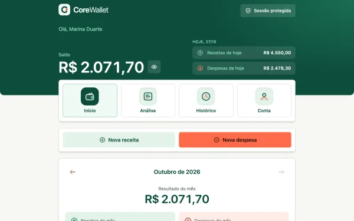
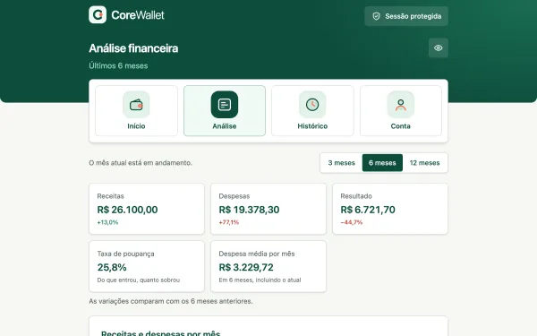
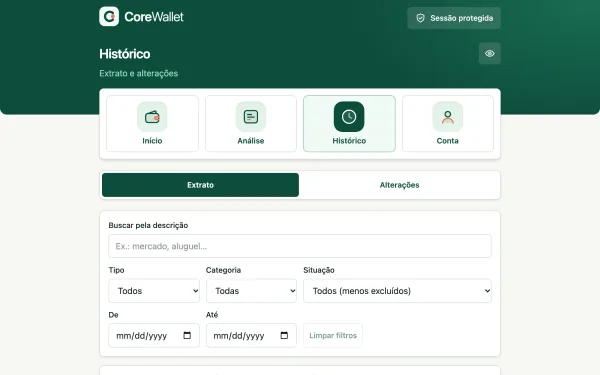
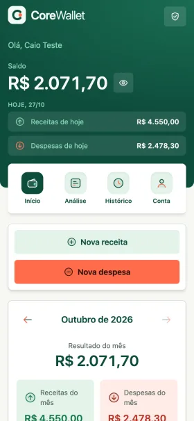
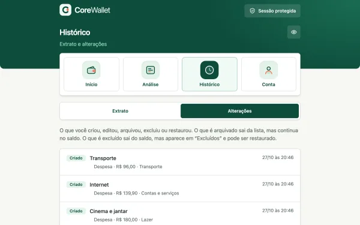
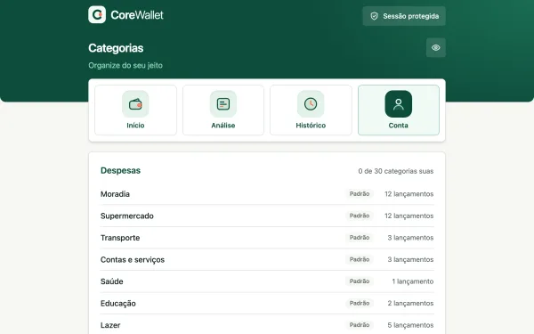
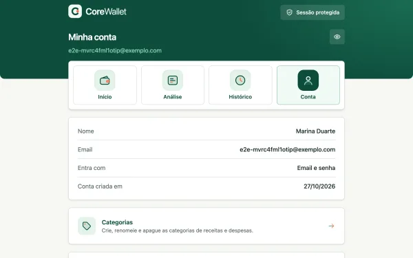
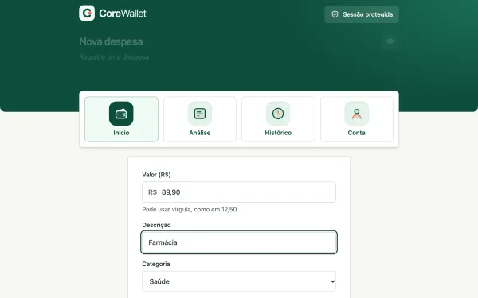

# CoreWallet

Carteira de receitas e despesas, inspirada no projeto do curso de React da [DIO](https://www.dio.me/) ([SPA original](https://github.com/codethi/diowallet-spa) · [API original](https://github.com/codethi/diowallet-api)). Front e API no mesmo repositório, com foco em segurança e em contas que não mentem.

<p>Clique em uma miniatura para ver a tela inteira.</p>
<table>
  <tr>
    <td align="center"><a href="docs/img/inicio.png"></a><br /><sub>Início</sub></td>
    <td align="center"><a href="docs/img/analise.png"></a><br /><sub>Análise</sub></td>
    <td align="center"><a href="docs/img/historico.png"></a><br /><sub>Extrato</sub></td>
    <td align="center"><a href="docs/img/inicio-celular.png"></a><br /><sub>Celular</sub></td>
  </tr>
  <tr>
    <td align="center"><a href="docs/img/alteracoes.png"></a><br /><sub>Alterações</sub></td>
    <td align="center"><a href="docs/img/categorias.png"></a><br /><sub>Categorias</sub></td>
    <td align="center"><a href="docs/img/conta.png"></a><br /><sub>Conta</sub></td>
    <td align="center"><a href="docs/img/nova-saida.png"></a><br /><sub>Nova despesa</sub></td>
  </tr>
  <tr>
    <td align="center" colspan="4"><a href="docs/img/entrar-cloudflare.png"></a><br /><sub>Login com a verificação da Cloudflare (Turnstile)</sub></td>
  </tr>
</table>

## O que tem

- **Lançamentos:** receitas e despesas com categoria, edição, exclusão com "Desfazer" e arquivamento.
- **Início:** saldo geral, receitas e despesas **de hoje** (dia do servidor, em Brasília), resumo do mês e despesas por categoria em anel. O olhinho esconde todos os valores.
- **Análise financeira:** indicadores, receitas e despesas por mês, evolução do saldo, comparação com o mês anterior, categorias com variação e maiores despesas, em períodos de 3, 6 ou 12 meses.
- **Extrato:** todos os lançamentos, com busca e filtros por tipo, categoria, situação e datas.
- **Alterações:** tudo o que é criado, editado, arquivado, excluído ou restaurado fica registrado. Excluído sai da lista e do saldo, mas pode ser restaurado; arquivado sai da lista, mas continua contando.
- **Categorias próprias:** criar, renomear e apagar (escolhendo para onde vão os lançamentos).
- **Entrar:** email e senha ou Google, com verificação anti-robô, confirmação de email (quando há SMTP) e verificação em duas etapas opcional (Google Authenticator, Authy, 1Password…).
- **Sessão segura:** acesso de 15 minutos renovado sozinho, dispositivos conectados que dá para encerrar, proteção CSRF e limite de tentativas.

## Stack

JavaScript em todo o projeto (sem TypeScript), com as bibliotecas do curso em versões atuais.

- **Front (`web/`):** React, Vite, TailwindCSS, React Router, React Hook Form, Zod, Axios. Ícones, marca e gráficos são desenhados à mão, sem biblioteca.
- **API (`api/`):** Node, Express, MongoDB (Mongoose), bcrypt, jsonwebtoken, helmet.
- **Compartilhado (`shared/`):** schemas Zod usados pelo front e pela API.
- **Testes (`e2e/`):** Playwright.

## Como rodar

Precisa de Node 24 (`nvm use`) e Docker.

```bash
cp .env.example .env      # preencha MONGO_ROOT_PASSWORD (openssl rand -hex 16) e JWT_SECRET (openssl rand -hex 48)
npm install
```

Tudo no Docker, como em produção, em http://localhost:8080:

```bash
docker compose up -d --build
```

Desenvolvimento (Mongo no Docker, API e front no seu computador, com recarga automática), em http://localhost:5173:

```bash
docker compose up -d --wait mongo
npm run dev:api
npm run dev:web
```

| Comando | O que faz |
|---|---|
| `npm run lint` | ESLint no front e na API |
| `npm test` | Testes de `shared`, da API e do front |
| `npm run test:e2e` | Testes de ponta a ponta no Chromium |
| `npm run build` | Build de produção do front |

Detalhes dos testes em [docs/TESTES.md](docs/TESTES.md).

## Documentação

| Documento | Conteúdo |
|---|---|
| [Configuração](docs/CONFIGURACAO.md) | Variáveis do `.env`, login com Google, captcha, confirmação de email e verificação em duas etapas |
| [Publicar](docs/DEPLOY.md) | Subir em um servidor com Docker e túnel da Cloudflare |
| [Servidor caseiro](docs/LAB.md) | Exemplo de como rodar em um servidor de casa com túnel |
| [Desempenho e escala](docs/DESEMPENHO.md) | Várias cópias da API, estado compartilhado no Mongo e medidas de carga |
| [Segurança](docs/SEGURANCA.md) | O que o projeto faz a mais que o curso, e como |
| [API](docs/API.md) | Rotas |
| [Testes](docs/TESTES.md) | Camadas de teste e como rodar cada uma |
| [Limites conhecidos](docs/LIMITES.md) | O que ainda não existe ou funciona de forma simplificada |

## Licença

MIT
